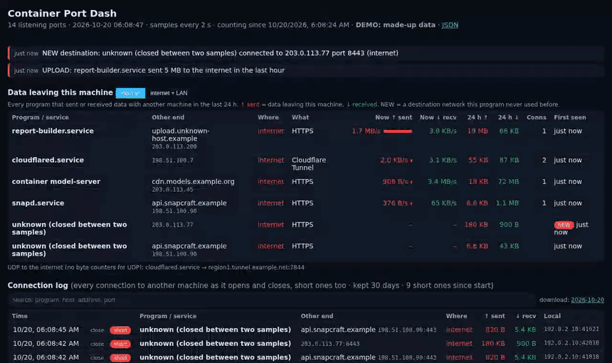

<h1 align="center">Lion Studio - Container Port Dash</h1>
<p align="center"><b>Every port on your Linux machine, what it is, who owns it, and where your data goes</b><br>
One small container shows every listening port in plain words, the service or container behind it, the live traffic on it,
every program that sends data to another machine, and a log of every connection, short ones too. Turn your own services
on and off, and kill a port with your login password. Built on and for an NVIDIA DGX Spark; runs on any Linux machine with Docker.</p>

<p align="center"><em>Created by <a href="https://github.com/sunnychase">Sunny Chase</a> in collaboration with Claude (Anthropic).</em></p>

<p align="center"><a href="docs/media/tour.mp4"></a><br>
<sub>Demo mode: every service, host and address in it is made up. Click for the video.</sub></p>

## What it shows

| Section | What you see |
|---|---|
| **Alerts** | a program that reaches a network it never used before; a program sending more than 100 MB an hour to the internet; a port newly open to the LAN |
| **Data leaving this machine** | every program, service or container that exchanged data with another machine in the last 24 h: the other end (address and name, internet or LAN), what it is (HTTPS, DNS, SSH …), bytes sent ↑ and received ↓ now and in total, first seen, NEW |
| **Connection log** | every connection to another machine as it opens and as it closes, with its bytes, kept 30 days, searchable, one file per day to download |
| **Last 24 hours by program** | sent and received, to the internet and to the LAN |
| **Your services** | ON / OFF switches for your systemd --user services |
| **Every listening port** | port, who can reach it (this machine only, or the LAN), what it is, the owner, connections and live in / out rates; click a row to see who is connected; **Kill** |

Owners are exact: each socket's cgroup names the systemd service, the Docker container or the program that holds it,
including root services and containers. Descriptions come from systemd, from Docker, from a table of well-known ports and
services, or from your own notes (`DATA/descriptions.json`, e.g. `{"8530": "bench builder", "container:chat-ui": "the chat"}`).

## Kill

Kill asks for **your login password** (checked by the machine's own SSH server; never stored) and shows exactly what it will
do before it does it:

| Owner | Kill does | To undo |
|---|---|---|
| your systemd --user service | stops it and disables it | switch it ON under Your services (starts and enables it) |
| a temporary (transient) service | stops it; it disappears | start it again the way it was started |
| your own program | asks it to close, forces it after 5 s | start it again |
| a Docker container | stops it and turns its automatic restart off; **nothing is deleted** | `docker start NAME` |
| a system service (SSH, DNS, printing …) | nothing: view only | — |

Five wrong passwords lock Kill for 15 minutes; every attempt is written to `DATA/audit.log`.

## Run it

```bash
git clone https://github.com/sunnychase/lion-studio-container-port-dash.git
cd lion-studio-container-port-dash
./run.sh                      # builds the image, starts "container-port-dash" on port 8660
```

Open `http://<machine>:8660`. `run.sh` makes a panel token for the switches in `~/container-port-dash-data/token`.
Settings (environment, all optional): `PORT`, `DATA`, `NAME` for `run.sh`; inside the container `PORTS_SAMPLE_S` (2),
`PORTS_UPLOAD_ALERT_MB` (100), `PORTS_LOG_DAYS` (30), `PORTS_LOG_LOCAL` (1 = log connections inside the machine too),
`PORTS_LAN` (extra networks to count as LAN). HTTPS: put `cert.pem` and `key.pem` in `DATA/tls/`.

Try it without touching anything: `PORTS_DEMO=1 PORTS_DATA=/tmp/pd PORTS_LAN=192.0.2.0/24 python3 app.py` serves made-up data.

## How it works

- `ss -tuaneiH` every 2 s: every socket with its owner's cgroup and, for TCP, the bytes sent and received on each connection.
  The difference between two samples is the traffic; nothing needs root.
- `ss -E`: the kernel reports each socket as it closes, with its final counters, so connections that live less than a
  sample are still recorded (their program is named only if a sample saw them).
- The Docker socket names and stops containers; `busctl` over your user D-Bus manages your systemd --user services.
- Totals, first-seen times and alerts are kept in `DATA/traffic.json`; the connection log in `DATA/connlog/`.
- One Python file, standard library plus paramiko for the password check.

## Limits (read before you trust it)

It sees what your account can see. **A program running as root can hide from it**: use it as an early warning and confirm
on your router or firewall. Short connections are logged with their bytes and destination but without their program, UDP
has no byte counters, and DNS lookups show as the local resolver. See [SECURITY.md](SECURITY.md) for what the container
can do and why.

## Tests

`tests/check.sh`: the socket parser, the owner rules, and the page in demo mode (alerts, the log, Kill refused on a system
port, wrong passwords locked out, the right one acting), plus a privacy grep.

## Licence

MIT, see [LICENSE](LICENSE) and [NOTICE.md](NOTICE.md).
